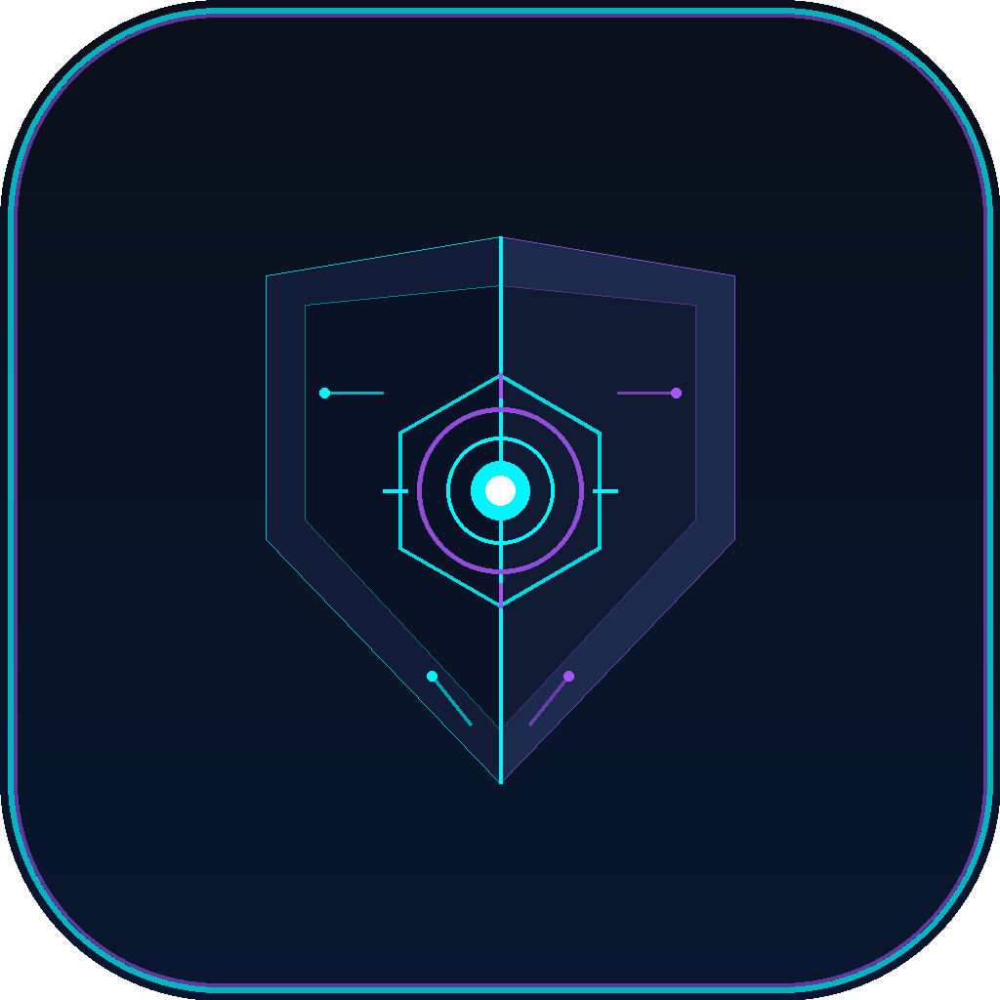

<div align="center">
  
  
  # AgentSentinel™
  ### Zero-Trust AST Runtime Firewall & Prompt-Injection Interceptor for Autonomous AI Agents, Tool Calls, and MCP Servers

  <p>
    <a href="https://github.com/marketplace/actions/agentsentinel-ai-security-gate"></a>
    <a href="https://getagentsentinel.com"></a>
    <a href="https://getagentsentinel.com/install.html"></a>
  </p>

  <p>
    
    
    
    
  </p>
</div>

---

## ⚡ The 2026 Autonomous AI Agent Security Problem

Modern LLMs (Claude Code, Cursor, AutoGen, CrewAI, LangChain, MCP tools) have moved from passive chat completion to **autonomous tool execution**:
- Spawning bash commands & terminals (`run_command`)
- Querying production SQL databases (`sql_query`)
- Signing and settling on-chain transactions (`transfer_funds`, `spend_allowance`)

When an agent operates with tools, traditional static linters (Snyk, SonarQube) fail completely because **they cannot inspect runtime tool calls or indirect prompt injections hidden inside codebase files, PR diffs, or dynamic LLM outputs.**

> **If an adversarial PR tricks an AI agent into exfiltrating AWS keys, draining a Soroban allowance, or executing a destructive shell command, your entire infrastructure is compromised.**

---

## 🛡️ How AgentSentinel Protects Your Repositories

AgentSentinel acts as a **Deterministic Zero-Trust Runtime AST Firewall**:

```
[ Incoming PR / Agent Action ]
               │
               ▼
┌────────────────────────────────────────────────────────┐
│        🛡️  AgentSentinel AI Security Gate              │
├────────────────────────────────────────────────────────┤
│  1. AST Syntax & Grammar Invariant Verifier            │
│  2. Adversarial Prompt-Injection Interceptor           │
│  3. AI Agent Wallet & Budget Drainer Guard (Web3)      │
│  4. Malicious NPM Postinstall & Supply Chain Hunter    │
└────────────────────────────────────────────────────────┘
               │
         [PASS / BLOCK]
               ▼
[ 🟢 Safe Production Merge OR 🔴 Instant Quarantine ]
```

---

## 🏛️ The 4 Core Defense Invariants

| Invariant | Protection Vector | Industry Vulnerability Solved |
| :--- | :--- | :--- |
| **1. Agent Wallet Drainer Guard** | Enforces hard mathematical caps on Soroban/EVM allowances. | Prevents runaway agent spending or wallet draining bugs. |
| **2. Prompt Injection Interceptor** | Scans AST & markdown files for hidden jailbreaks & exfiltration probes. | Eliminates indirect prompt injections from untrusted PRs. |
| **3. Supply Chain Shield** | Intercepts obfuscated `package.json` `postinstall` commands and curl binaries. | Neutralizes malicious dependency hijacking in CI/CD. |
| **4. Strict Credential Isolation** | Detects and quarantines Stellar seeds, EVM keys, AWS secrets, and PATs. | Zero accidental credential leaks on public GitHub branches. |

---

## 🚀 Live Production Case Study: Securing AgentRail Protocol

AgentSentinel protects the **[AgentRail Protocol](https://github.com/SorobanAgents/agentrail)** — Stellar's autonomous AI agent scoped-allowance & micro-settlement protocol.

Every single Pull Request submitted by contributors is audited in real-time by the AgentSentinel Security Gate, ensuring zero malicious dependencies and mathematically proven invariant safety.

```markdown
## 🛡️ AgentSentinel AI Security Gate v1.0.0
### Zero-Trust AST Firewall & Prompt-Injection Interceptor

| Metric | Result |
| :--- | :--- |
| **Files Audited** | 68 |
| **Threats Detected** | 0 |
| **Strict TypeScript / Zod** | ✅ Verified |
| **Dependency Telemetry Scan** | ✅ Clean (0 external network leaks) |
| **Security Verdict** | 🟢 **PASSED (Zero-Trust Verified)** |

> All automated safety invariants and AST security rules have passed successfully. PR is clean and safe to merge.
```

---

## ⚡ 1-Click Installation (Zero YAML Required)

You can connect AgentSentinel to your repositories in **one single click** without touching any YAML files:

👉 **[Launch 1-Click Installer at getagentsentinel.com/install.html](https://getagentsentinel.com/install.html)**

### Or via GitHub Actions (`.github/workflows/agentsentinel.yml`):

```yaml
name: AgentSentinel Security Gate

on:
  push:
    branches: [main, master]
  pull_request:
    branches: [main, master]

jobs:
  zero-trust-audit:
    name: Zero-Trust AI Agent Audit
    runs-on: ubuntu-latest
    permissions:
      contents: read
      pull-requests: write
      issues: write

    steps:
      - name: Checkout Codebase
        uses: actions/checkout@v4

      - name: Run AgentSentinel Security Gate
        uses: sparkysolutions10-pixel/agentsentinel-action@v1
        with:
          github-token: ${{ secrets.GITHUB_TOKEN }}
          strict: 'true'
```

---

## 🏢 Enterprise & Commercial Attestation

For enterprise deployments requiring SOC2 Type II compliance attestation, custom on-premise enclaves, and unlimited team seats:

* **Official Website:** [getagentsentinel.com](https://getagentsentinel.com)
* **Security Advisories:** [getagentsentinel.com/advisories.html](https://getagentsentinel.com/advisories.html)
* **Interactive Playground:** [getagentsentinel.com/playground.html](https://getagentsentinel.com/playground.html)

---

<div align="center">
  <p>© 2026 AgentSentinel Inc. / Sparky Solutions. All rights reserved.</p>
  <p><strong>Securing the Autonomous AI Agent Economy.</strong></p>
</div>
